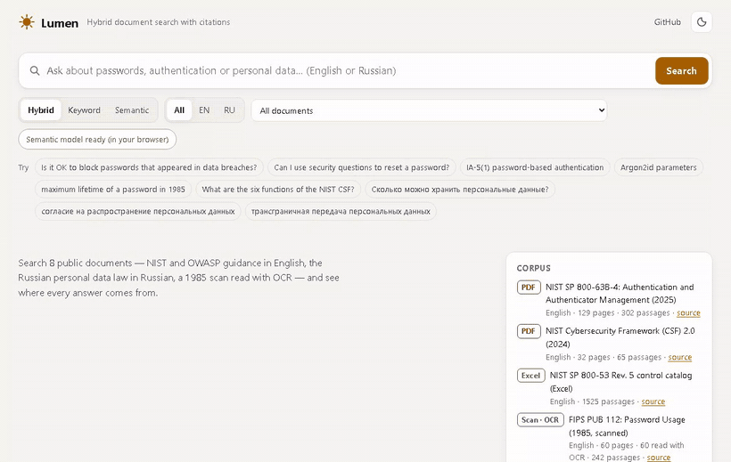
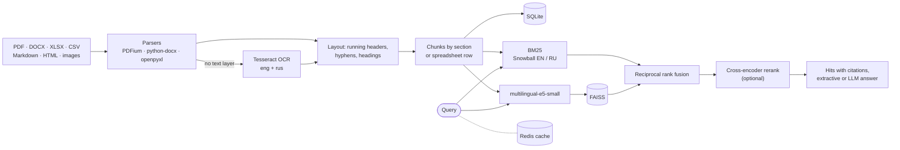

# Lumen Search

[](https://github.com/kyan9400/lumen-search/actions/workflows/ci.yml)
[](https://kyan9400.github.io/lumen-search/)
[](LICENSE)


**Hybrid document search with citations: BM25 and multilingual embeddings over PDF, Word, Excel and
scanned pages, in English and Russian.**

**Live demo: [kyan9400.github.io/lumen-search](https://kyan9400.github.io/lumen-search/).** It runs
entirely in your browser: the same BM25, multilingual-e5-small embeddings and rank fusion as the server,
over an exported index of 8 public documents (2,342 passages). The full service — FastAPI, FAISS,
Redis, OCR on upload and cross-encoder reranking — starts with `docker compose up`.



## What it does

- **Reads real documents.** PDF (born-digital and scanned), Word, Excel and CSV, Markdown, HTML, plain
  text and images. Pages without a text layer go through Tesseract OCR (English and Russian); the
  confidence is kept with every passage.
- **Cites precisely.** Chunks follow the document's structure — PDF bookmarks and numbered headings,
  Word heading styles, Markdown headings, one spreadsheet row per record — so each result points to a
  page and section, an article of a law, or a sheet and row.
- **Searches two ways and fuses them.** BM25 over Snowball-stemmed English and Russian words finds exact
  identifiers (`IA-5(1)`, `Argon2id`); multilingual-e5-small embeddings in FAISS find paraphrases.
  Reciprocal rank fusion merges the two rankings, and an optional multilingual cross-encoder reorders
  the top 10.
- **Answers with sources.** An extractive answer quotes the best sentences with numbered citations. With
  any OpenAI-compatible endpoint configured (Ollama, vLLM, OpenAI), a generated answer cites the same
  sources and falls back to the extractive one if the model is unavailable.
- **Runs as a service.** FastAPI with search, answer, upload and delete endpoints, an API key for writes,
  a Redis cache with an in-process fallback, Prometheus metrics, and a small web UI with no build step.

## Retrieval quality

62 hand-labelled questions over the corpus: 44 in English, 18 in Russian, 7 of them asking in one
language about a document in the other. A question's answer is labelled by location — a page, a section,
a spreadsheet row, or a phrase — so the labels survive changes to chunking
([eval/questions.jsonl](eval/questions.jsonl)).

| Retrieval | Hit@1 | Hit@5 | Recall@10 | MRR@10 | nDCG@10 | p50 latency |
| --- | ---: | ---: | ---: | ---: | ---: | ---: |
| BM25 | 54.8% | 67.7% | 73.8% | 0.605 | 0.621 | 3 ms |
| Dense (multilingual-e5-small + FAISS) | 48.4% | 75.8% | 77.8% | 0.600 | 0.624 | 43 ms |
| **Hybrid (RRF)** | 56.5% | 75.8% | 79.8% | 0.653 | 0.664 | 44 ms |
| **Hybrid + rerank** (top 10, mMiniLM cross-encoder) | 62.9% | 83.9% | 79.8% | 0.704 | 0.708 | 0.98 s |

- Hybrid beats either retriever alone on recall and MRR: BM25 wins on identifiers and exact wording,
  embeddings on paraphrases and Russian word forms.
- Questions that share words with the answer are nearly solved (hybrid Hit@5 96.8%, 100% reranked).
  Paraphrases are where the cross-encoder earns its cost: Hit@5 rises from 66.7% to 83.3%.
- Reranking the top 20 instead of the top 10 lifts Recall@10 to 85.9% at 1.8 times the latency.
- Cross-lingual questions remain the weak spot (1 of 7 found in the top 5): in a mixed-language corpus,
  e5-small prefers passages in the language of the question.

Measured with `lumen eval` on a laptop CPU (16 threads), with the cache off and the models loaded; all
tables, by language and question type, are in [eval/results.md](eval/results.md).

## Quick start

### Docker: the full service

```bash
docker compose up --build
```

Open <http://localhost:8000> for the UI and <http://localhost:8000/docs> for the OpenAPI reference. The
first start indexes `corpus/` (a few minutes, most of it OCR); Redis caches results and query embeddings.

```bash
# upload a document (the compose file sets the key to "change-me")
curl -X POST localhost:8000/api/documents -H "X-API-Key: change-me" -F "file=@report.pdf"
```

### Python

```bash
python -m venv .venv && source .venv/bin/activate
pip install torch --index-url https://download.pytorch.org/whl/cpu   # CPU build; skip for CUDA
pip install -e ".[dev]"
lumen ingest --manifest corpus/manifest.json      # the two scans need Tesseract (eng + rus)
lumen search "IA-5(1) password-based authentication"
lumen answer "Сколько можно хранить персональные данные?"
lumen serve                                        # http://localhost:8000
```

`lumen --model hash ...` runs everything without downloading a model (a lexical hashing embedder, used
by the tests).

## API

| Method | Path | |
| --- | --- | --- |
| `GET` | `/api/search?q=&k=&mode=hybrid\|bm25\|dense&doc=&lang=en\|ru&rerank=` | Ranked hits with citation, highlights and every score |
| `POST` | `/api/answer` | `{"question": "...", "k": 5}` → answer with numbered citations and its sources |
| `GET` | `/api/documents`, `/api/documents/{id}`, `/api/documents/{id}/file` | Indexed documents and the original files |
| `GET` | `/api/chunks/{id}` | A passage with the passages around it |
| `POST` | `/api/documents` | Upload (multipart, `X-API-Key`); the same file twice is indexed once |
| `DELETE` | `/api/documents/{id}` | Remove a document, its chunks and vectors (`X-API-Key`) |
| `GET` | `/api/health`, `/metrics` | Status (models, cache, OCR) and Prometheus metrics |

A hit from `GET /api/search?q=IA-5(1) password-based authentication&k=1&rerank=false` (text shortened):

```json
{
  "rank": 1,
  "doc_id": "nist-sp-800-53r5-controls",
  "title": "NIST SP 800-53 Rev. 5 control catalog (Excel)",
  "media_type": "xlsx",
  "text": "Control Identifier: IA-5(1)\nControl (or Control Enhancement) Name: Authenticator Managemen …",
  "highlights": [[20, 22], [23, 24], [25, 26]],
  "location": {
    "label": "Sheet 'SP 800-53 Revision 5', row 420 · IA-5(1) Authenticator Management | Password-based Authentication",
    "sheet": "SP 800-53 Revision 5",
    "row_start": 420,
    "row_end": 420,
    "section": "IA-5(1) Authenticator Management | Password-based Authentication"
  },
  "ocr_confidence": null,
  "scores": { "score": 0.032522, "fused": 0.032522, "bm25": 16.7434, "bm25_rank": 1, "dense": 0.8891, "dense_rank": 2, "rerank": null },
  "file_url": "/api/documents/nist-sp-800-53r5-controls/file"
}
```

## Configuration

Environment variables (or a `.env` file):

| Variable | Default | |
| --- | --- | --- |
| `LUMEN_DATA_DIR` | `data` | SQLite database, FAISS index and copies of the source files |
| `LUMEN_EMBEDDING_MODEL` | `intfloat/multilingual-e5-small` | Any sentence-transformers model; `hash` for none |
| `LUMEN_RERANKER_MODEL` | *(off)* | e.g. `cross-encoder/mmarco-mMiniLMv2-L12-H384-v1` |
| `LUMEN_RERANK_TOP` | `10` | Candidates the cross-encoder reorders |
| `LUMEN_REDIS_URL` | *(in-process cache)* | e.g. `redis://localhost:6379/0` |
| `LUMEN_API_KEY` | *(writes disabled)* | Required for uploads and deletions |
| `LUMEN_OCR_MODE` | `auto` | `auto` (pages without text), `always` or `never` |
| `LUMEN_OCR_LANGUAGES` | `eng+rus` | Tesseract language packs |
| `LUMEN_CHUNK_WORDS` / `LUMEN_CHUNK_OVERLAP_WORDS` | `180` / `30` | Chunk size and overlap |
| `LUMEN_FAISS_INDEX` | `flat` | `flat` (exact) or `hnsw` |
| `LUMEN_LLM_BASE_URL`, `LUMEN_LLM_MODEL`, `LUMEN_LLM_API_KEY` | *(off)* | OpenAI-compatible endpoint for generated answers |
| `LUMEN_MAX_UPLOAD_MB`, `LUMEN_MAX_PAGES` | `25`, `500` | Upload limits |
| `LUMEN_BOOTSTRAP_MANIFEST` | *(off)* | Index a corpus manifest on start-up when the index is empty |

## How it works



- **Rank fusion instead of score blending.** BM25 scores and cosine similarities live on unrelated
  scales; reciprocal rank fusion (`Σ 1 / (60 + rank)`) needs only ranks and has nothing to tune.
- **PDF clean-up before chunking.** Running headers and footers are found by repetition across pages,
  table-of-contents lines are dropped, PDF bookmarks and numbered headings become section paths, and words
  hyphenated across lines are rejoined using the document's own vocabulary: "look-up" and "out-of-band"
  keep their hyphens, "authen-tication" does not.
- **OCR only where needed.** In `auto` mode a page is OCRed when its text layer is missing or broken.
  Pages are rendered one at a time and recognised by parallel Tesseract processes, each limited to one
  thread — set per process, so the embedding model in the main process keeps all cores.
- **Titles in the embeddings.** Passages are embedded as *title, section path, text*; on the evaluation
  set that raised the dense MRR from 0.577 to 0.600.
- **One source of truth.** SQLite holds documents and chunks; on start-up the FAISS index is reconciled
  with it (missing vectors are re-embedded, orphans removed), so a crash between the two writes heals
  itself. Cache keys include an index version, so a new document invalidates cached results.
- **A cache that cannot take search down.** Redis calls have short timeouts; after an error Redis is left
  alone for 30 seconds and searches run uncached.
- **Untrusted uploads.** The file type is checked against its first bytes and, for Office files, its
  package structure; size and page limits apply; writes need an API key compared in constant time. The
  container runs as a non-root user on a read-only file system.

### The in-browser demo

The static demo is the same web UI with a different backend: `scripts/build_demo.py` exports the chunks
and int8-quantised vectors, and the page rebuilds BM25 from the texts with a JavaScript port of the
analyzer (the official Snowball stemmers). `tests/test_js_parity.py` runs the JavaScript engine in
Node.js and checks that tokens, BM25 scores and fused rankings equal the Python ones.

Queries are embedded in the browser by transformers.js and ONNX Runtime Web, served from the same site
(no CDN). The int8 ONNX model weighs 118 MB, 96 MB of it word embeddings for 250,000 vocabulary pieces in
100 languages. `scripts/build_browser_model.py` keeps the 114,796 pieces made of ASCII and Cyrillic
characters, which brings the model to 66 MB with exactly the same output for English and Russian text:
SentencePiece only ever uses pieces that occur in the text, and the script verifies bit-identical
hidden states.

## Corpus

| Document | Format | Language |
| --- | --- | --- |
| NIST SP 800-63B-4: Authentication and Authenticator Management (2025) | PDF, 129 pages | English |
| NIST Cybersecurity Framework 2.0 (2024) | PDF, 32 pages | English |
| NIST SP 800-53 Rev. 5 control catalog | Excel, 1,189 controls | English |
| FIPS PUB 112: Password Usage (1985) | Scanned PDF, 60 pages, OCR | English |
| OWASP Password Storage and Authentication cheat sheets | Markdown | English |
| Federal Law No. 152-FZ "On Personal Data" | Word | Russian |
| Federal Law No. 519-FZ of 30.12.2020, official publication | Scanned PDF, 8 pages, OCR | Russian |

Sources, licences and checksums are in [corpus/README.md](corpus/README.md): U.S. government works,
OWASP cheat sheets under CC BY-SA 4.0, and Russian official documents, which are not subject to copyright.

## Development

```bash
pytest                        # unit, API and JavaScript-parity tests; OCR tests run when Tesseract is installed
ruff check . && ruff format --check .
mypy                          # strict
```

CI runs the tests on Python 3.10, 3.11 and 3.12 with Tesseract installed, checks the corpus checksums,
builds the Docker image and smoke-tests it: upload a scanned PDF, OCR it, search it, and see the second
search come from Redis. The Demo workflow builds the browser model, indexes the corpus and publishes the
static site to GitHub Pages.

```
src/lumen/
  ingest/        parsers: pdf.py (PDFium + OCR), office.py (Word, Excel, CSV), markup.py, ocr.py, layout.py
  chunking.py    structure-aware chunks         textproc.py   normalisation, stemming, sentences
  bm25.py        sparse BM25                    vectors.py    FAISS wrapper
  engine.py      ingestion, hybrid search, RRF, reranking, answers
  api.py         FastAPI app                    cli.py        lumen command
  evaluate.py    retrieval metrics              export.py     static demo data
  web/           UI (also the static demo)      onnx_embedder.py  the browser model, in Python
corpus/          documents, manifest, fetch script
eval/            labelled questions
scripts/         browser model and static demo builds
```

## Limitations

- Cross-lingual retrieval is weak with e5-small (see the table); a larger multilingual model such as
  bge-m3 would help at several times the cost per query.
- The index lives in one process: exact FAISS search is fast to a few hundred thousand chunks; beyond
  that, the HNSW option or a vector database.
- OCR quality depends on the scan; the Tesseract confidence of each passage is stored and shown.
- The static demo has no reranker and no uploads.

## License

MIT. The documents in `corpus/` keep their own licences.
